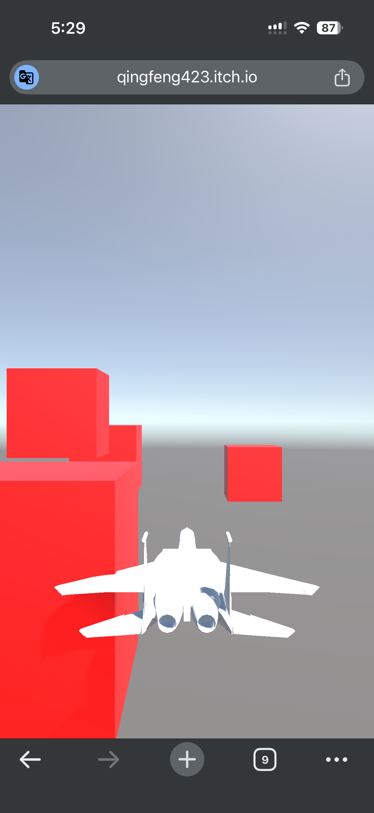
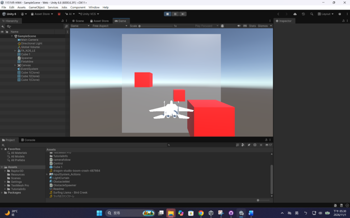

https://github.com/Qingfeng423/1151VR-HW4-414262129--
https://youtu.be/W1fjLiBqvj8
Unity 3D 飛行閃避遊戲：製作流程與操作說明
一、 核心開發流程與系統架構
1.	專案建立與模型匯入：
o	在 Unity 中建立 3D 專案，匯入 3D 飛行器模型與障礙物 Prefab，並設定好攝影機跟隨腳本（Camera Follow），確保視角能順暢鎖定並跟隨飛機移動。

2.	飛行控制與物理碰撞（防穿模設定）：
o	為飛機掛載 Rigidbody，並將 Collision Detection 設為 Continuous Dynamic 防止高速穿模。
o	寫入 AirplaneController 腳本，透過新版 Input System 接收鍵盤與方向控制，實現飛行移動、俯仰與旋轉。
o	障礙物設定 Collider 並取消 Is Trigger，觸發 OnCollisionEnter 時判定死亡並重啟遊戲。

3.	動態障礙物生成機制：
o	透過 ObstacleSpawner 腳本使用協程（Coroutine），定時在飛機前方隨機位置生成障礙物 Prefab，並在 10 秒後自動銷毀以優化效能。

4.	音效與 BGM 整合：
o	於場景中掛載 Audio Source，分別加入飛行循環音效（Fly Sound）、碰撞爆炸音效（Hit Sound）及過關音效（Pass Sound），營造沉浸式飛行體驗。

二、 視覺特效與過關 UI 實作
1.	半透明發光光幕（Finish Line）：
o	建立終點線方塊並放大尺寸，透過自製的 LightCurtain 材質球，將渲染模式設為 Transparent（透明），並開啟 Emission（發光）調整強度，呈現高科技能量牆的視覺效果。
o	設定 Box Collider 並勾選 Is Trigger，透過 OnTriggerEnter 偵測 Tag 為 Finish 的過關判定。

2.	「YOU WIN」過關介面：
o	使用 TextMeshPro 建立過關文字 UI，透過 Rect Transform 置中對齊螢幕。
o	預設將 UI 關閉（Inactive），當飛機觸碰終點光幕時，透過腳本啟動 UI 顯示、凍結飛機剛體（isKinematic = true），並延遲 2 秒重新載入場景。

三、 手機端觸控與跨平台支援
1.	行動裝置虛擬搖桿 (On-Screen Stick)：
o	為了支援手機遊玩，於 Canvas 建立 UI Image 作為虛擬搖桿，並掛載 On-Screen Stick 元件。
o	將 Control Path 綁定至 Gamepad -> Left Stick，無須額外寫複雜的手勢觸控扣，就能直接將大拇指滑動轉化為遊戲搖桿訊號。

2.	APK 打包輸出：
o	進入 File -> Build Settings，將平台切換為 Android，完成專案打包與輸出，以確保手機上能順利進行觸控遊玩測試。

四、 版本控制、協作與發布部署
1.	GitHub 版本控制：
o	於 GitHub 建立公開 Repository（命名格式：1151VR-HW4-學號-姓名），並套用 Unity 專用之 .gitignore 檔案過濾大型暫存檔。
o	使用 GitHub Desktop 進行本地端 Commit 與 Push，並將專案權限共給老師信箱 (cchu.fju@gmail.com)。

2.	itch.io 與 YouTube 平台發布：
o	將專案輸出為 WebGL 網頁版（包成 .zip）或 Android 格式，上傳至 itch.io 建立專案頁面供玩家遊玩。
o	實際操作遊戲並透過螢幕錄影擷取關鍵過關與遊玩畫面，剪輯後上傳至個人 YouTube 頻道留存備查。
